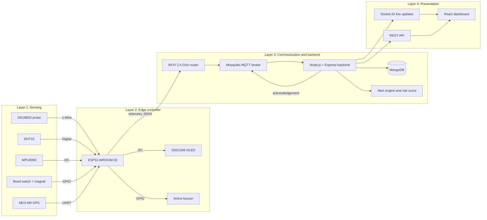
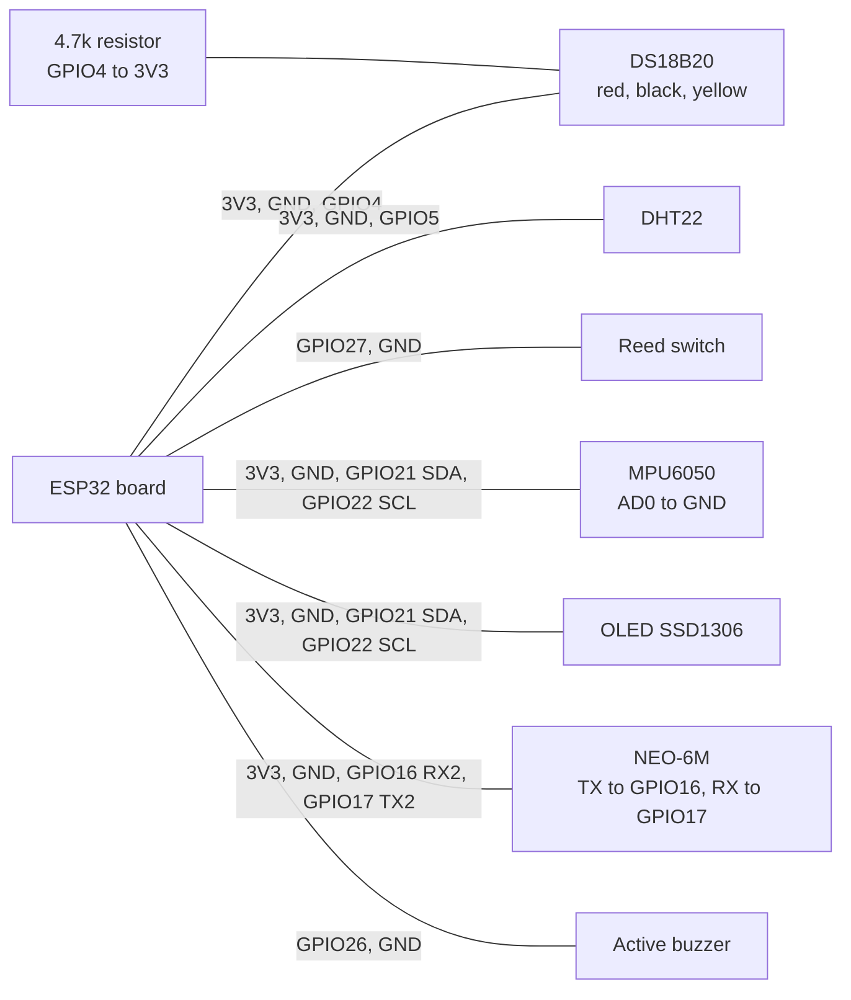

# Cold-Chain Guardian

**IoT-Based Cold-Chain Monitoring and Alert System**

Cold-Chain Guardian watches temperature-sensitive products, such as medicines, while they are stored or transported. An ESP32 device inside the box measures product temperature, ambient temperature and humidity, lid opening, shocks and location. It sends the data over Wi-Fi to a backend that validates, stores and checks it, raises alerts, and shows everything live on a web dashboard.

> **Educational prototype.** It is not a certified medical or regulatory device. Do not use it to make decisions about real medicines or vaccines.

---

## Table of contents

1. [Features](#features)
2. [System block diagram](#system-block-diagram)
3. [Data flow](#data-flow)
4. [Hardware list and device roles](#hardware-list-and-device-roles)
5. [Circuit diagram and connections](#circuit-diagram-and-connections)
6. [Wiring notes](#wiring-notes)
7. [MQTT topics and payload](#mqtt-topics-and-payload)
8. [Alerts and risk score](#alerts-and-risk-score)
9. [Tech stack](#tech-stack)
10. [Project structure](#project-structure)
11. [Installation and run](#installation-and-run)
12. [Firmware setup](#firmware-setup)
13. [Users and security](#users-and-security)
14. [What is tested and what is not](#what-is-tested-and-what-is-not)
15. [What makes it different](#what-makes-it-different)
16. [Pros and cons](#pros-and-cons)
17. [Limitations](#limitations)
18. [Future scope](#future-scope)
19. [SDGs](#sustainable-development-goals)
20. [Troubleshooting](#troubleshooting)

---

## Features

- Live product temperature (DS18B20), ambient temperature and humidity (DHT22)
- Lid open/closed detection (reed switch and magnet)
- Motion and shock detection (MPU6050)
- GPS location (NEO-6M) with honest handling of no-fix and stale positions
- OLED status screen and buzzer on the device
- MQTT delivery with unique record IDs, backend acknowledgement and duplicate protection
- Alert engine with debounce, hysteresis, excursion duration and severity
- Explainable 0 to 100 risk score
- React dashboard: live cards, charts with limit lines, map with planned route and travelled path, shipments, alerts, reports, CSV export
- Login with admin and viewer roles, new accounts need admin approval
- Simulator that sends clearly labelled DEMO data through the same path
- Automated tests (validation, alert logic, risk score, API, auth)

---

## System block diagram



---

## Data flow

1. The ESP32 reads all sensors every 5 seconds.
2. It builds one JSON record with a unique record ID. A value that cannot be measured is sent as `null`, never as an invented number.
3. It publishes the record to `coldchain/CC-001/telemetry`.
4. The backend validates every field with Zod and rejects damaged or impossible data.
5. A repeated record ID is ignored (unique index on `deviceId` + `recordId`).
6. The record is stored with two times: the time it was measured and the time it arrived.
7. The backend publishes an acknowledgement on `coldchain/CC-001/ack`.
8. The alert engine opens or closes alerts and the risk score is recalculated.
9. Socket.IO pushes the update to the dashboard.

---

## Hardware list and device roles

| Device | Role | Why it is used |
|---|---|---|
| ESP32-WROOM-32 | Reads sensors, drives OLED and buzzer, connects to Wi-Fi, sends data | Built-in Wi-Fi, enough pins, cheap |
| DS18B20 waterproof probe | Product temperature | Waterproof, about 0.5 °C accuracy |
| DHT22 | Ambient temperature and humidity | Shows outside conditions around the box |
| MPU6050 | Accelerometer and gyroscope | Detects drops, bumps and rough handling |
| Reed switch + magnet | Lid open or closed | Simple and reliable digital input |
| NEO-6M GPS | Location | Tracks the shipment, needs sky view |
| 0.96" SSD1306 OLED | Local status display | Read values without a computer |
| Active buzzer | Local warning sound | Immediate on-site alert |
| 4.7 kΩ resistor | DS18B20 data pull-up | Reliable 1-Wire reading |
| USB 5 V supply | Powers ESP32 and 3.3 V sensors | Simple and safe for the prototype |

**Planned, not built yet:** microSD module (offline queue), 18650 battery, TP4056 charger, MT3608 boost converter, battery voltage divider on GPIO34.

---

## Circuit diagram and connections

### Connection diagram



### Pin map

| Module | Module pin | ESP32 pin | Note |
|---|---|---|---|
| DS18B20 | Red | 3V3 | Power |
| DS18B20 | Black | GND | Ground |
| DS18B20 | Yellow (data) | GPIO4 | 4.7 kΩ resistor between GPIO4 and 3V3 recommended |
| DHT22 | + / - / OUT | 3V3 / GND / GPIO5 | Digital single wire |
| Reed switch | Leg 1 / Leg 2 | GPIO27 / GND | Internal pull-up. Magnet near = closed = LOW |
| MPU6050 | VCC / GND | 3V3 / GND | Power |
| MPU6050 | SDA / SCL | GPIO21 / GPIO22 | I2C address 0x68 |
| MPU6050 | AD0 | GND | Fixes address at 0x68 |
| OLED SSD1306 | V2 / V1 | 3V3 / GND | On this OLED unit V2 is power and V1 is ground. Check yours |
| OLED SSD1306 | SDA / SCL | GPIO21 / GPIO22 | Same I2C bus, address 0x3C |
| NEO-6M | VCC / GND | 3V3 / GND | Power |
| NEO-6M | TX | GPIO16 (RX2) | GPS sends, ESP32 receives, 9600 baud |
| NEO-6M | RX | GPIO17 (TX2) | ESP32 sends, GPS receives |
| Buzzer | + / - | GPIO26 / GND | Driven directly for short beeps |

### Wiring notes

- **I2C is shared.** The OLED (0x3C) and MPU6050 (0x68) use different addresses, so both sit on GPIO21 and GPIO22.
- **Pull-up on the probe.** The DS18B20 can only pull its data line down. A 4.7 kΩ resistor to 3.3 V pulls it up. The ESP32 internal pull-up worked in testing, but a real resistor is more reliable.
- **Reed switch.** The pin is held HIGH by the ESP32. A magnet closes the switch and the pin reads LOW, which the firmware treats as lid closed. A 50 ms debounce ignores flicker. Keep the magnet about 2 to 5 mm from the switch and handle the glass switch gently.
- **GPS lines cross.** GPS TX goes to ESP32 RX (GPIO16). GPS RX goes to ESP32 TX (GPIO17).
- **Avoided pins.** GPIO0, 2, 12 and 15 affect boot. GPIO34 and 35 are input only. GPIO6 to 11 are used by flash. None are used for sensors.
- **Never connect a raw 3.7 V lithium cell to the 3V3 pin.** A full cell reads up to 4.2 V. Use a proper regulator or boost converter.
- **TP4056 has no power-path function.** It is a charger, not a complete power supply.
- **Keep electronics dry.** Only the probe tip and cable go in the cold compartment.

---

## MQTT topics and payload

Topics:

```
coldchain/{deviceId}/telemetry
coldchain/{deviceId}/status
coldchain/{deviceId}/events
coldchain/{deviceId}/config
coldchain/{deviceId}/commands
coldchain/{deviceId}/ack
```

Example telemetry (values are illustrative, real values come from the sensors):

```json
{
  "schemaVersion": 1,
  "deviceId": "CC-001",
  "recordId": "CC-001-1a2b3c4d-000042",
  "timestamp": "2026-01-01T10:00:00.000Z",
  "temperatureC": 5.2,
  "humidityPct": 61.0,
  "ambientTemperatureC": 6.1,
  "latitude": null,
  "longitude": null,
  "gpsFix": false,
  "gpsSatellites": 0,
  "batteryVoltage": null,
  "batteryPct": null,
  "lidOpen": false,
  "motionDetected": false,
  "shockDetected": false,
  "sensors": { "ds18b20": "ok", "dht22": "ok", "mpu6050": "ok", "gps": "no_fix" },
  "network": { "wifiConnected": true, "mqttConnected": true },
  "dataSource": "live",
  "isSimulated": false
}
```

Record IDs follow `DEVICE-bootId-sequence`. Unavailable values are `null`. Acknowledgements are `stored`, `duplicate` or `rejected`.

---

## Alerts and risk score

| Alert | When it appears |
|---|---|
| Temperature high or low | Outside the safe range for 3 readings in a row |
| Long excursion | Outside the range longer than a set time (default 30 min) |
| Sensor failure | A sensor reports an error or is missing |
| Lid opened | Magnet moves away. Critical after 5 min |
| Shock | Acceleration reaches the limit (default 2.5 g), 30 s pause between events |
| Low battery | Estimated battery at or below the limit (once battery is measured) |
| Stale or offline | No data for 2 min (stale) or 5 min (offline) |
| GPS unavailable | No valid fix for a long time. Off by default |

Debounce prevents one bad reading from raising an alert. Hysteresis (default 0.3 °C) stops alerts flickering open and closed. Probable causes are shown as unconfirmed guesses.

**Risk score (0 to 100)**

| Factor | Max points | Full points when |
|---|---|---|
| Temperature deviation | 25 | Largest deviation reaches 5 °C |
| Time outside limits | 30 | Total time reaches 60 min |
| Sensor failures | 15 | Product probe fails, or 5 per other failing sensor |
| Low battery | 10 | Battery at or below critical level |
| Shocks | 10 | Two or more shock events |
| Disconnection | 10 | 30 min offline |

Levels: 0 to 24 low, 25 to 49 moderate, 50 to 74 high, 75 to 100 critical.

> The score is a project-defined indicator, not a scientifically proven probability of damage.

---

## Tech stack

| Part | Technology |
|---|---|
| Firmware | Arduino C++ on ESP32 (PubSubClient, Adafruit SSD1306/GFX, DHT, TinyGPSPlus, OneWire, DallasTemperature) |
| Broker | Mosquitto (Docker) |
| Backend | Node.js (ES modules), Express, Mongoose, Zod, Winston, Socket.IO, JWT, bcryptjs |
| Database | MongoDB (Docker) |
| Frontend | React, Vite, Tailwind CSS v4, Recharts, Leaflet and OpenStreetMap, Socket.IO client |
| Routing and search | OSRM (planned route), Nominatim (location search) |
| Tests | Vitest, Supertest |

---

## Project structure

```
cold-chain-guardian/
  backend/        Express API, MQTT handling, alert engine, models, tests, scripts
  frontend/       React dashboard
  simulator/      Labelled DEMO telemetry publisher
  mqtt/           Mosquitto configuration
  docs/           Extra documentation
  docker-compose.yml
```

---

## Installation and run

Requirements: Node.js 20 or newer, Docker with Compose, Arduino IDE.

Default local ports (chosen to avoid common conflicts):

| Service | Port |
|---|---|
| MQTT broker | 1893 |
| MongoDB | 27117 |
| Backend API | 5055 |
| Frontend (Vite) | 5175 |

```bash
git clone <your-repo-url>
cd cold-chain-guardian

docker compose up -d

cd backend
npm install
cp .env.example .env
node scripts/createAdmin.js
npm run dev
```

In a second terminal:

```bash
cd cold-chain-guardian/frontend
npm install
cp .env.example .env
npm run dev
```

Open `http://localhost:5175` and sign in with the admin you created.

Optional commands:

```bash
cd backend
npm test
node scripts/seedShipment.js
node scripts/publishTest.js
```

Key backend `.env` values (placeholders only, never commit real secrets):

```
PORT=5055
MONGO_URI=mongodb://127.0.0.1:27117/coldchain
MQTT_URL=mqtt://127.0.0.1:1893
JWT_SECRET=change-this-to-a-long-random-string
```

Windows firewall: allow inbound TCP 1893 on the Private network profile so the ESP32 can reach the broker.

---

## Firmware setup

1. Install the ESP32 board package in Arduino IDE.
2. Install libraries: PubSubClient, Adafruit SSD1306, Adafruit GFX, DHT sensor library, TinyGPSPlus, OneWire, DallasTemperature.
3. Open the sketch and edit the settings at the top:

```cpp
const char *WIFI_SSID = "YOUR_WIFI_NAME";
const char *WIFI_PASS = "YOUR_WIFI_PASSWORD";
const char *MQTT_HOST = "YOUR_PC_IP";
const uint16_t MQTT_PORT = 1893;
const char *DEVICE_ID = "CC-001";
```

4. Find your PC IP with `ipconfig` (Windows) and use the IPv4 address of your Wi-Fi adapter. It changes when you change networks, so update and re-upload. A DHCP reservation on the router avoids this.
5. Select the ESP32 Dev Module board and upload. Open Serial Monitor at 115200 baud.

Never publish your real Wi-Fi password in a public repository.

---

## Users and security

- Roles: **admin** (full access) and **viewer** (read only).
- Signup creates a pending viewer account. An admin must approve it.
- Passwords are hashed with bcrypt. Login is rate limited, with lockout after 5 failures. Changing a password invalidates old tokens.
- Role rules are enforced by the backend, not only by hiding buttons.
- The local MQTT broker is anonymous and unencrypted. Use only on a private network. For real deployment add MQTT credentials, TLS and HTTPS.

---

## What is tested and what is not

**Tested and working**

- OLED, DHT22, reed switch, MPU6050 (about 1 g at rest) and DS18B20 probe individually
- At room temperature the probe read 31.56 °C and the DHT22 31.8 °C
- GPS wiring and NMEA data stream (no checksum errors)
- ESP32 to Wi-Fi to MQTT to backend to dashboard, with acknowledgements
- Alerts for high temperature, lid opening and missing sensor
- Login, signup approval and roles
- Simulator and automated tests (duplicates, invalid values, GPS loss, disconnection)

**Not done yet**

- microSD offline queue
- Battery power and battery level measurement
- Outdoor GPS fix and moving route tracking
- Cold-range accuracy tests (ice water or fridge)
- Test inside the full insulated box with gel packs

---

## What makes it different

Temperature monitors with an ESP32 and a dashboard already exist, so this is not a brand-new invention. What sets it apart is the combination and the care taken with data.

| Area | Basic approach | This project |
|---|---|---|
| Measured | Temperature only | Product and ambient temperature, humidity, lid, shocks, location, device health |
| Delivery | Send and hope | Unique record IDs, acknowledgement, duplicate protection |
| Alerts | Simple limit check | Debounce, hysteresis, excursion duration, severity, unconfirmed causes |
| Bad data | Wrong values shown | Impossible values become null and the sensor shows an error |
| Location | May show 0,0 or a guess | Never plots 0,0, separates real GPS from a fixed site, marks old positions as last known |
| Time | Server clock only | Keeps measured time and arrival time separately |
| Risk | None | Published 0 to 100 formula, labelled project-defined |
| Dashboard | Ready-made app | Own full-stack app with charts, map, shipments, reports, CSV |
| Access | None | Login, approval, roles |
| Testing | Manual | Labelled simulator and automated tests |

---

## Pros and cons

**Pros**

- Low cost with common parts
- Several conditions monitored together
- Live dashboard and quick alerts
- Careful data handling and fewer false alarms
- Honest about failures and missing location
- Configurable limits and shipments without code changes
- Easy to test and explain

**Cons**

- Needs Wi-Fi and an always-on computer for the broker and backend
- No offline storage yet
- USB powered until the battery circuit is built
- GPS does not work indoors or inside a closed metal box
- Breadboard build, not strong enough for real transport
- Low-cost, uncalibrated sensors
- Server IP changes with the network

---

## Limitations

- Prototype only, not certified
- DS18B20 about 0.5 °C accuracy and uncalibrated. DHT22 is less accurate. Battery percentage will be an estimate from voltage
- The reed switch shows magnet nearness, not a sealed lid
- The shock limit is a chosen number, real damage may differ
- GPS needs sky view and a first fix can take minutes
- Wi-Fi only, no mobile network
- Anonymous, unencrypted local MQTT
- Login tokens are stored in the browser, no refresh tokens
- The alert engine skips records older than the last one processed, so a backlog must upload before new live data
- Free map and search services are for light use and need internet
- The risk score is a simple formula, not a scientific model
- Tested with one real device only

---

## Future scope

| Idea | Benefit |
|---|---|
| microSD offline queue | No readings lost in outages, upload later with original time, delete only after acknowledgement |
| 18650 battery, TP4056, boost converter | Run without USB and measure battery level |
| Outdoor GPS and route tracking | Real travelled path |
| GSM or LTE | Work without Wi-Fi |
| MQTT credentials, TLS, HTTPS | Secure deployment |
| Cold-range calibration | Check the probe at 0 °C and fridge temperature |
| SMS, email, phone notifications | Reach people away from the dashboard |
| Predictive analysis | Warn before a limit is crossed |
| PCB and sealed enclosure | Replace the breadboard |
| More sensors and compartments | Second probe, light sensor |
| Standards and compliance | Calibrated sensors, tamper-proof logs and audit trails |

---

## Sustainable Development Goals

- **SDG 3, Good Health and Well-being (main):** helps keep medicines and vaccines effective until they reach patients (target 3.8)
- **SDG 9, Industry, Innovation and Infrastructure:** low-cost IoT built with open tools
- **SDG 12, Responsible Consumption and Production:** early warnings reduce spoilage and waste (target 12.3)

The project supports these goals. It does not claim to achieve them, since it is an untested prototype.

---

## Troubleshooting

| Problem | Likely cause and fix |
|---|---|
| MQTT state -2 on the ESP32 | PC IP changed. Run `ipconfig`, update `MQTT_HOST`, re-upload. Check the firewall rule and that Docker is running |
| `wifi:sta is connecting` spam | Use the latest firmware with the 20 s retry logic |
| DS18B20 shows 0 devices | Check the yellow wire on GPIO4, add the 4.7 kΩ pull-up, check power |
| MPU6050 or OLED not found | Loose wires. Run an I2C scan, expect 0x3C and 0x68 |
| GPS NO DATA | Check TX to GPIO16 and RX to GPIO17, 9600 baud, loose wires |
| GPS has data but no fix | Take it outdoors with a clear sky and wait several minutes |
| Lid always reads open | Magnet too far or reed switch not closing. Keep it 2 to 5 mm away |
| Dashboard shows old shipment on map | Pick the shipment in the Live Tracking dropdown, and complete the old shipment on the same device |
| Cannot log in | Create an admin with `node scripts/createAdmin.js`. Pending accounts need admin approval |

---

## License and credits

Student project. Add your preferred license here.

Map data from OpenStreetMap contributors. Routing from OSRM. Place search from Nominatim.
